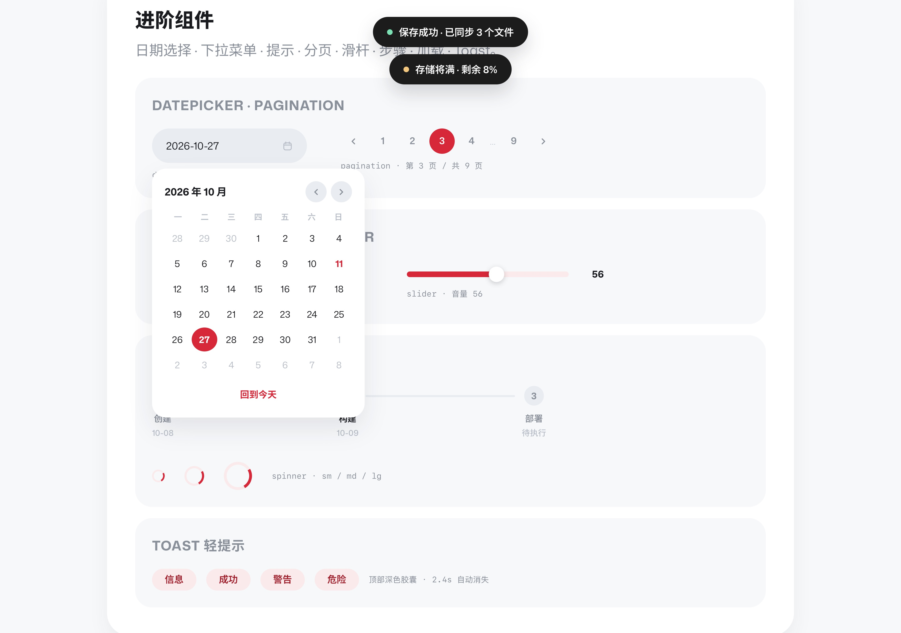
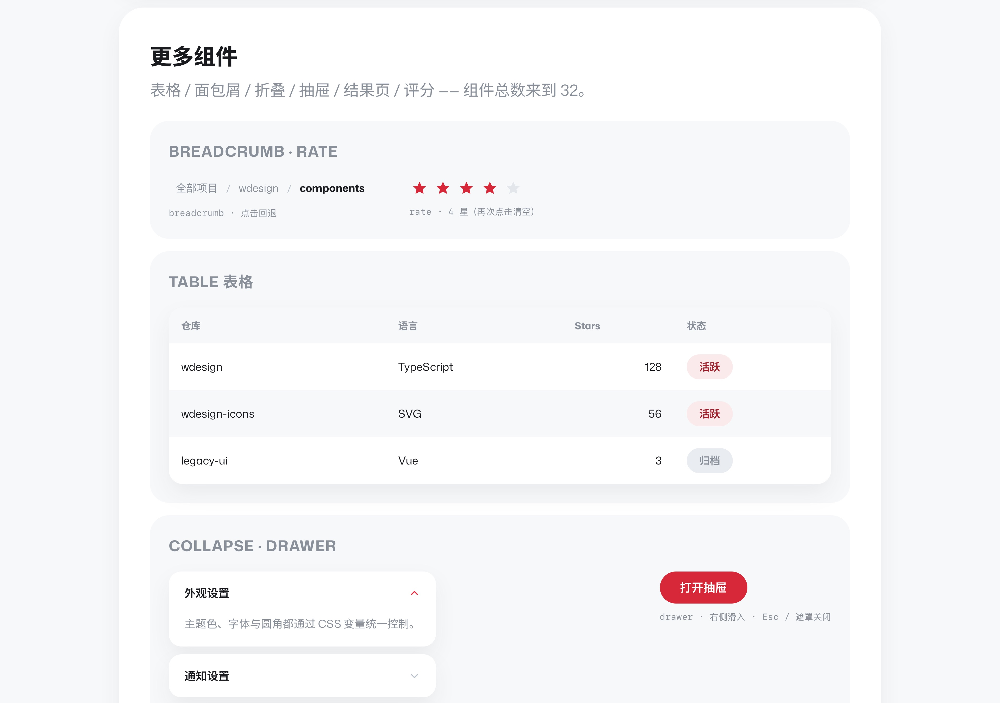
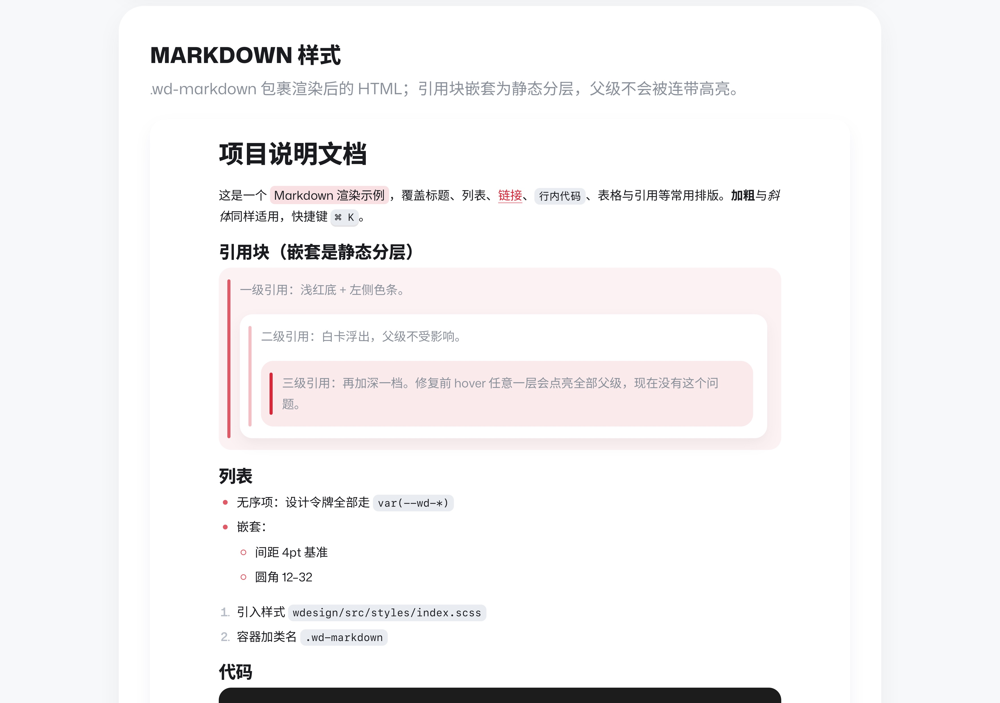
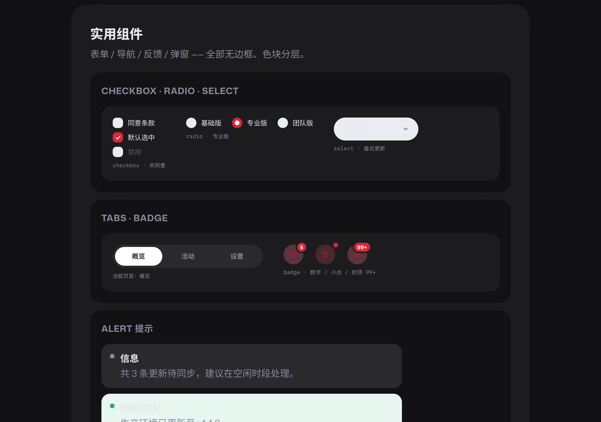
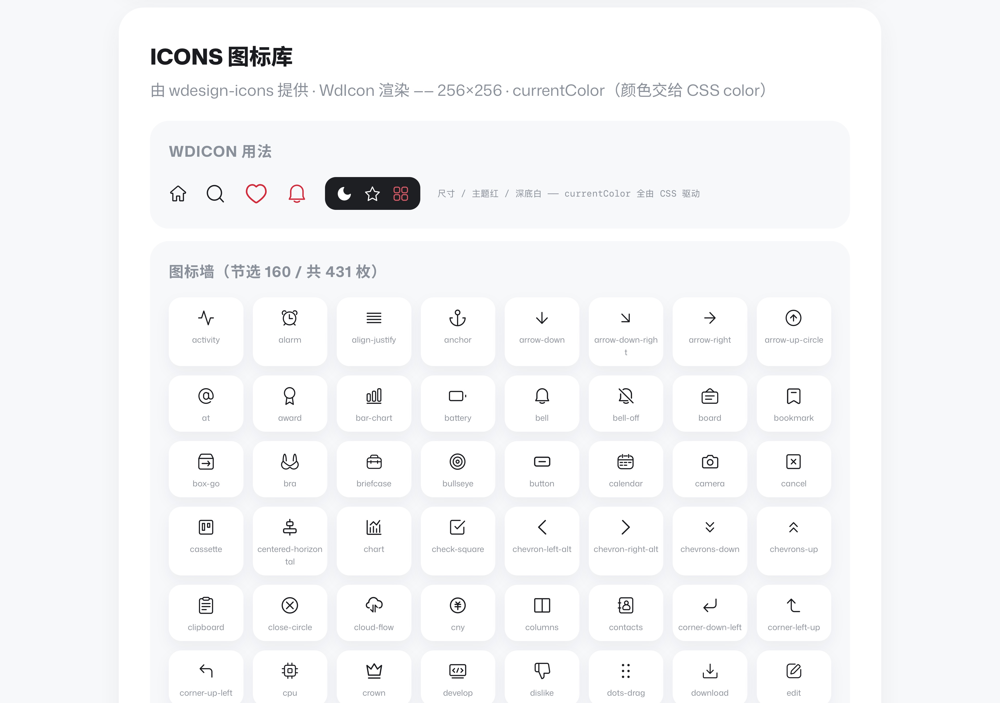

# WDesign

**WDesign** — 一套「无边框 · 色块分层 · 全圆角」的现代扁平设计系统（SCSS + Vue3）。

- 主题色 `#D62839`（浅色 / 深色模式下恒定）；深色两级 `#1C1C1C` / `#2F2F2F`
- 字体：拉丁 **Mona Sans** + 中文 **思源黑体（Source Han Sans SC）** —— 均为 VF 可变字体
- 无毛玻璃、无渐变、无描边 —— 区域只用色块与留白区分

## Packages

| 包 | 说明 |
|---|---|
| [`packages/wdesign`](./packages/wdesign) | SCSS + Vue3 组件库：**32 个组件** + Markdown 样式 + 动效体系 |
| [`packages/wdesign-icons`](./packages/wdesign-icons) | 图标库：**595 个 SVG** · 256×256 · currentColor · kebab-case |

## 快速开始

```bash
# 1. 把两个包拷进你的项目（保持同级，如 src/wdesign、src/wdesign-icons）
# 2. 安装 sass
npm i -D sass
```

```ts
import { createApp } from 'vue'
import WdUI from './wdesign/src'
import './wdesign/src/styles/index.scss'

createApp(App).use(WdUI).mount('#app')
```

```vue
<WdButton variant="primary">按钮</WdButton>
<WdIcon name="heart" :size="28" style="color: var(--wd-red)" />
```

- 组件总览与 API：见 [packages/wdesign/README.md](./packages/wdesign/README.md)
- 图标库用法：见 [packages/wdesign-icons/README.md](./packages/wdesign-icons/README.md)
- 可视化设计规范：[design-system.html](./design-system.html)（浏览器打开）
- 离线演示（含全部组件交互）：`packages/wdesign/demo/index.html`

## Preview







## License

[MIT](./LICENSE)
